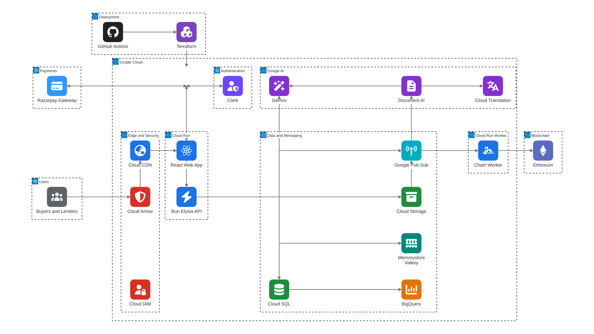

# Realdha

> **One permanent record for every property in India.**  
> *Google Cloud Buildathon '26*

Realdha transforms piles of fragmented Indian land documents into one permanent, cryptographically verified record. Powered by Google Document AI and Gemini, Realdha cross-references regional land records (such as Maharashtra 7/12 extracts, sale deeds, and mutation entries), flags anomalies with page-level citations, obtains legal sign-off, and anchors tamper-evident fingerprints onto the blockchain with a linked 3D digital twin.

---

## Architecture



*The vector diagram is available in [docs/architecture/realdha-architecture.svg](docs/architecture/realdha-architecture.svg) and source definition in [docs/architecture/realdha-architecture.mmd](docs/architecture/realdha-architecture.mmd).*

### System Overview

Realdha is built on a scalable, modern Google Cloud native foundation deployed via Terraform:

1. **Edge & Security**
   - **Cloud Armor & Cloud CDN**: Ingress protection, rate limiting, and low-latency asset delivery.
   - **Cloud IAM**: Least-privilege role-based access control across service accounts (`realdha-backend-sa`, `realdha-ui-sa`).

2. **Application Runtime (Google Cloud Run v2)**
   - **Frontend UI (`realdha-ui`)**: React 19 application bundled with Vite, served via Nginx with dynamic runtime environment injection (`BACKEND_URL`).
   - **Backend API (`backend`)**: High-throughput REST API built with Bun 1.4.5 and Elysia, providing type-safe OpenAPI/Swagger documentation at `/swagger`.

3. **Google AI & Document Intelligence**
   - **Google Document AI**: Specialized OCR and entity extraction for Indian land and title documents.
   - **Cloud Translation API**: First-class multilingual extraction and translation for Marathi and Hindi land registry scripts.
   - **Google Gemini**: Automated cross-document analysis, clause comparison, anomaly detection, and citation-grounded verification reports.

4. **Data & Messaging Tier**
   - **Google Cloud Storage (GCS)**: Encrypted document vault storing scanned deeds, 7/12 extracts, and NOCs.
   - **Cloud SQL & Firestore**: Relational and document databases storing property metadata, digital twin records, and structured transaction history.
   - **Memorystore (Valkey)**: In-memory cache for ultra-fast query and session acceleration.
   - **BigQuery**: Analytics engine for regional valuation benchmarks and property distribution trends.
   - **Google Cloud Pub/Sub**: Event-driven message bus orchestrating document ingestion, AI pipelines, and blockchain anchor tasks.

5. **Blockchain Anchoring**
   - **Cloud Run Chain Worker**: Consumes Pub/Sub verification events and computes cryptographic SHA-256 state fingerprints.
   - **Ethereum (Sepolia Testnet)**: Anchors immutable document proofs to detect unauthorized alterations without exposing private land data or handling custody of investor funds.

6. **Identity & Payments**
   - **Clerk**: Seamless identity management and phone OTP authentication.
   - **Razorpay**: Gateway integration for title search and verification fees.

---

## Repository Structure

```
.
├── backend/                  # REST API (Bun 1.4.5, Elysia, TypeScript, Drizzle ORM)
│   ├── src/
│   │   ├── app.ts            # Elysia application configuration and OpenAPI setup
│   │   ├── index.ts          # Server entrypoint and graceful shutdown
│   │   ├── config/env.ts     # Strongly typed environment configuration
│   │   ├── modules/          # Business domains (Flats, Search, Verification)
│   │   └── routes/           # REST endpoints (health, info, etc.)
│   └── test/                 # Test suites using bun:test
│
├── realdha-ui/               # Single-page web application (React 19, Vite, Tailwind CSS)
│   ├── src/
│   │   ├── screens/          # Workflow screens (Verification, Search, Digital Twin)
│   │   ├── components/       # Accessible UI components (Radix UI primitives)
│   │   └── styles/           # Devanagari-compliant typography and design tokens
│   └── nginx.conf.template   # Production container Nginx reverse proxy
│
├── terraform/                # Infrastructure as Code (Terraform 1.9.5)
│   ├── main.tf               # Cloud Run v2, Artifact Registry, IAM bindings
│   ├── variables.tf          # Configurable variables with validation guards
│   ├── outputs.tf            # Service URLs and resource identifiers
│   └── README.md             # IaC deployment instructions
│
├── docs/                     # Project documentation & architecture assets
│   ├── architecture/         # Architecture diagrams (.png, .svg, .mmd) & render scripts
│   └── github-actions-setup.md # Keyless CI/CD with Workload Identity Federation
│
├── AGENTS.md                 # Agent and developer coding guidelines
├── DESIGN.md                 # UI/UX design system and accessibility tokens
└── PRODUCT.md                # Product requirements and operating context
```

---

## Core Features

- **Regional Land Record Verification**: Specialized pipelines for Maharashtra land records—7/12 extracts (सातबारा उतारा), Sale Deeds (खरेदीखत), Mutation Entries (फेरफार नोंद), and RERA certificates.
- **Proof Over Promise**: Every AI verification finding includes severity ratings (High, Medium, Low), source quotes, and exact page citations.
- **Devanagari First-Class Support**: Native support for English, Marathi (मराठी), and Hindi (हिंदी) with adjusted line-heights for Devanagari matras and conjuncts.
- **Cryptographic Non-Repudiation**: Hashes of verified records anchored on Sepolia testnet to guarantee immutability.
- **3D Spatial Digital Twin**: Visual representation of physical land and tower units linked to verified title records.

---

## Getting Started

### Prerequisites

- [Bun](https://bun.sh/) (v1.4.5 or later)
- [Node.js](https://nodejs.org/) (v22 or later) & `npm`
- [Terraform](https://www.terraform.io/) (v1.9.5 or later)
- [Docker](https://www.docker.com/) (optional, for local container validation)

### 1. Backend Setup

```bash
cd backend

# Install dependencies
bun install

# Run in development mode with live reload (port 8080)
bun run dev

# Run unit and integration tests
bun test

# Validate TypeScript types
bun run typecheck
```

Access API documentation via Swagger UI at: `http://localhost:8080/swagger`  
Health probe endpoint: `http://localhost:8080/health`

### 2. Frontend UI Setup

```bash
cd realdha-ui

# Install dependencies
npm ci

# Start the Vite development server (port 5173)
npm run dev

# Lint code with oxlint
npm run lint

# Compile and build production bundle
npm run build
```

The UI communicates with the backend via the `/api` proxy or the configured `BACKEND_URL` environment variable.

### 3. Infrastructure & Cloud Deployment

Infrastructure is provisioned in Google Cloud region `us-central1` using Terraform:

```bash
cd terraform

# Create your local terraform.tfvars
cp terraform.tfvars.example terraform.tfvars

# Initialize Terraform plugins
terraform init

# Plan infrastructure changes
terraform plan

# Apply changes
terraform apply
```

For automated deployments via GitHub Actions and Workload Identity Federation (WIF), refer to [docs/github-actions-setup.md](docs/github-actions-setup.md).

---

## Engineering Standards

- **Backend**: Strict ESM, typed config via `src/config/env.ts`, standard error payload (`{ error, message, code }`), and tests co-located under `backend/test/`.
- **Frontend**: Accessible per WCAG 2.2 AA standards (4.5:1 contrast, 44px minimum touch targets, visible focus rings, non-color-exclusive status indicators).
- **Security**: Workload Identity Federation for keyless CI/CD, least-privilege service accounts, and sandboxed container workloads.

---

## Compliance & Disclaimer

- **DEMO · TESTNET · NOT AN OFFER**: Realdha is an infrastructure verification demonstration built for the Google Cloud Buildathon. All property listings and sample records are illustrative.
- **Not Legal Advice**: AI-assisted document evaluations provide informational cross-checks only and require independent legal verification before property transactions.
