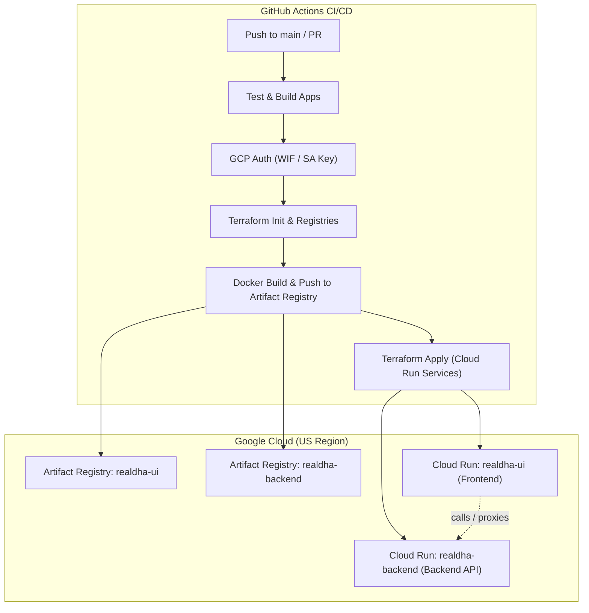

# GitHub Actions & Google Cloud Deployment Setup Guide

This guide walks you through setting up automated CI/CD for deploying both the **frontend (`realdha-ui`)** and **backend (`backend`)** to **Google Cloud Run** using **Terraform** and **GitHub Actions**.

---

## Architecture Overview



---

## 1. Required GitHub Secrets and Variables

Configure the following under **GitHub Repository > Settings > Secrets and variables > Actions**:

### Secrets (`Repository secrets`)

| Secret Name | Required | Description | Example |
| :--- | :---: | :--- | :--- |
| `GCP_PROJECT_ID` | **Yes** | Your Google Cloud Project ID | `my-buildathon-project-123` |
| `GCP_WORKLOAD_IDENTITY_PROVIDER` | **Recommended** | WIF Provider resource path (keyless auth) | `projects/123456789/locations/global/workloadIdentityPools/github-pool/providers/github-provider` |
| `GCP_SERVICE_ACCOUNT` | **Recommended** | Email of the deployment Service Account | `github-actions-sa@my-project.iam.gserviceaccount.com` |
| `GCP_SA_KEY` | *Alternative* | Base64 or plain JSON key for Service Account (if not using WIF) | `{"type": "service_account", ...}` |
| `GCS_TF_STATE_BUCKET` | *Optional* | GCS Bucket name for shared Terraform state storage | `my-tf-state-bucket` |
| `DB_PASSWORD` | **Recommended** | Cloud SQL password for the `realdha` user, passed as `TF_VAR_db_password`. Pins the password so a lost Terraform state can't rotate it and break the backend with `password authentication failed`. If unset, Terraform generates a random one. Use letters and digits only (it is embedded unescaped in `DATABASE_URL`). | `openssl rand -hex 16` |
| `CHAIN_RPC_URL` | *Optional* | JSON-RPC URL of the chain for property tokens; stored in Secret Manager (`TF_VAR_chain_rpc_url`). See `docs/blockchain.md`. | `https://sepolia.infura.io/v3/...` |
| `CHAIN_ADMIN_TOKEN` | *Optional* | Bearer token required to approve/anchor a property | `openssl rand -hex 32` |
| `CHAIN_OWNER_SALT` | *Optional* | Salt for on-chain owner references. Never change after tokens exist. | `openssl rand -hex 32` |

### Variables (`Repository variables`, Optional)

| Variable Name | Default | Description |
| :--- | :---: | :--- |
| `GCP_REGION` | `us-central1` | Target US Google Cloud region |

---

## 2. Authentication Option A: Workload Identity Federation (Recommended)

Workload Identity Federation removes the need to store long-lived JSON service account keys in GitHub.

Run the following Google Cloud Shell / `gcloud` commands:

```bash
# 1. Set environment variables
export PROJECT_ID="<YOUR_GCP_PROJECT_ID>"
export GITHUB_REPO="<YOUR_GITHUB_ORG_OR_USERNAME>/<YOUR_REPO_NAME>" # e.g. sagezoic/google_buildathon_26
export POOL_NAME="github-pool"
export PROVIDER_NAME="github-provider"
export SA_NAME="github-actions-deployer"

gcloud config set project $PROJECT_ID

# 2. Enable required Google Cloud APIs
gcloud services enable \
  iam.googleapis.com \
  cloudresourcemanager.googleapis.com \
  iamcredentials.googleapis.com \
  run.googleapis.com \
  artifactregistry.googleapis.com \
  sqladmin.googleapis.com

# 3. Create the deployment Service Account
gcloud iam service-accounts create $SA_NAME \
  --display-name="GitHub Actions Terraform Deployer"

export SA_EMAIL="${SA_NAME}@${PROJECT_ID}.iam.gserviceaccount.com"

# 4. Grant required IAM roles to the Service Account
for ROLE in \
  roles/run.admin \
  roles/artifactregistry.admin \
  roles/iam.serviceAccountUser \
  roles/serviceusage.serviceUsageAdmin \
  roles/resourcemanager.projectIamAdmin \
  roles/storage.admin \
  roles/cloudsql.admin \
  roles/documentai.admin
do
  gcloud projects add-iam-policy-binding $PROJECT_ID \
    --member="serviceAccount:${SA_EMAIL}" \
    --role="$ROLE"
done

# 5. Create Workload Identity Pool
gcloud iam workload-identity-pools create $POOL_NAME \
  --location="global" \
  --display-name="GitHub Actions Pool"

# 6. Create Workload Identity Provider in the pool
gcloud iam workload-identity-pools providers create-oidc $PROVIDER_NAME \
  --location="global" \
  --workload-identity-pool=$POOL_NAME \
  --display-name="GitHub Actions Provider" \
  --attribute-mapping="google.subject=assertion.sub,attribute.actor=assertion.actor,attribute.repository=assertion.repository" \
  --issuer-uri="https://token.actions.githubusercontent.com"

# 7. Bind GitHub repository to the Service Account
export POOL_ID=$(gcloud iam workload-identity-pools describe $POOL_NAME --location="global" --format="value(name)")

gcloud iam service-accounts add-iam-policy-binding $SA_EMAIL \
  --role="roles/iam.workloadIdentityUser" \
  --member="principalSet://iam.googleapis.com/${POOL_ID}/attribute.repository/${GITHUB_REPO}"

# 8. Get the Workload Identity Provider name for GitHub Secrets
gcloud iam workload-identity-pools providers describe $PROVIDER_NAME \
  --location="global" \
  --workload-identity-pool=$POOL_NAME \
  --format="value(name)"
```

Add the resulting output string as `GCP_WORKLOAD_IDENTITY_PROVIDER` and `${SA_EMAIL}` as `GCP_SERVICE_ACCOUNT` in your GitHub repository secrets!

---

## 3. Authentication Option B: Service Account Key (Alternative)

If you prefer using a standard service account key JSON:

```bash
# 1. Create key JSON
gcloud iam service-accounts keys create sa-key.json \
  --iam-account="${SA_EMAIL}"

# 2. Add content of sa-key.json as secret 'GCP_SA_KEY' in GitHub Repository Secrets.
```

---

## 4. (Recommended) Create GCS Bucket for Terraform Remote State

To maintain consistent Terraform state across CI/CD runs:

```bash
# Create bucket in US region
gcloud storage buckets create gs://${PROJECT_ID}-tf-state --location=us-central1

# Add secret GCS_TF_STATE_BUCKET in GitHub with value: <PROJECT_ID>-tf-state
```

---

## 5. Deployment Verification

When code is pushed to `main`:
1. **GitHub Actions** runs `.github/workflows/deploy.yml`.
2. Both **Frontend** (`realdha-ui`) and **Backend** (`backend`) unit tests/builds execute.
3. Terraform creates or confirms Google Cloud APIs and Artifact Registry repositories.
4. Docker images are built and pushed with commit SHA tags and `latest`.
5. Terraform applies Cloud Run services for both frontend and backend.
6. The public service endpoints will be displayed in the GitHub Actions **Step Summary**.
